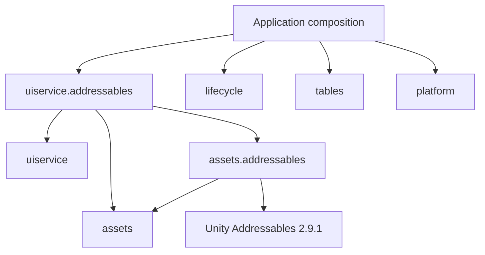

# JuahnFramework V2 modular infrastructure — 2026-11-09

The existing UiService, DI, simulation and motion APIs remain intact. New infrastructure is opt-in and follows the existing independent-package / adapter pattern.

| Package | Responsibility |
| --- | --- |
| [assets](https://github.com/armadimon/com.juahn.v2.assets) | Pure ownership contracts, shared loads, per-request cancellation, counted leases and explicit scopes |
| [assets.addressables](https://github.com/armadimon/com.juahn.v2.assets.addressables) | Addressables loading/release on Unity's captured main thread |
| [uiservice.addressables](https://github.com/armadimon/com.juahn.v2.uiservice.addressables) | Inactive UI instantiation and prefab retention through actual instance destruction |
| [lifecycle](https://github.com/armadimon/com.juahn.v2.lifecycle) | Ordered startup, progress, cancellation, rollback and reverse shutdown |
| [tables](https://github.com/armadimon/com.juahn.v2.tables) | Exact-version cache, schema/integrity checks and indexed row snapshots |
| [platform](https://github.com/armadimon/com.juahn.v2.platform) | Vendor-independent analytics, ads, auth and purchase contracts |

## Adoption order

1. Install Assets and the Addressables adapter through the consumer's UPM manifest. Pin each new Git package with `#v0.1.0`; list every Juahn Git dependency explicitly. Choose the existing UiService version already validated by your application.
2. Supply the UI loader through the existing `IUiAssetLoader` hook. Keep UI/pool leases until their instances are destroyed. Stop UI and dispose its loader before disposing an externally owned asset provider.
3. Keep DI registration in the application's composition root. Pass explicitly ordered modules to ModuleHost; put SDK initialization and game-specific failure/retry policies inside application adapters. Call lifecycle methods on Unity's main thread when modules use Unity objects.
4. Move table transport/parsing behind ITableSource/ITableDecoder/ITableCache. Keep row schemas and conversion into Sim IConfigProvider inside the game. Swap immutable configuration snapshots only at a controlled session boundary.
5. Implement vendor SDK adapters against Platform contracts. Keep backend authority, product/reward definitions and analytics event names inside the game.

The same package boundary validator and CI now protect the existing architecture, DI, sim, uiservice and vcontainer repositories. Pure architecture/sim additionally compile against .NET Standard 2.1. Peer-installed SDK requirements are recorded explicitly in package-policy.json; adding an adapter does not silently install another container or SDK.

## Executed verification

- Pure-core regressions: **51 passed** (Assets 16, Lifecycle 13, Tables 14, Platform 8).
- Unity **6000.3.11f1**, Addressables **2.9.1**, UniTask **2.5.11**, uGUI **2.0.0**: **13 PlayMode tests passed**.
- Unity tests include real registered Addressables prefab loading, missing-key failure, worker-thread dispatch, inactive/never-shown objects, late cancellation/destruction, external provider ownership and lifecycle main-thread continuity.
- New pure packages plus existing architecture/sim compile for **netstandard2.1**. Unity adapters compile against the real Unity/Addressables/UI assemblies.
- **11** package boundary checks and **4** deliberate invalid-input checks passed.

Run the isolated Unity harness from the UI adapter repository: `python3 Tools~/run_unity_tests.py --workspace /path/to/JuahnFrameworkV2 --unitask /path/to/UniTask --unity /path/to/Unity --project /path/to/empty-validation-project`. It builds local test content and never modifies a consumer game's manifest.

Research is documented in [design-sources.md](design-sources.md); machine-readable results are in [validation.json](validation.json). External account linking, live ad delivery, store purchases and remote content deployments are outside this verification. Application projects have not been automatically migrated.
